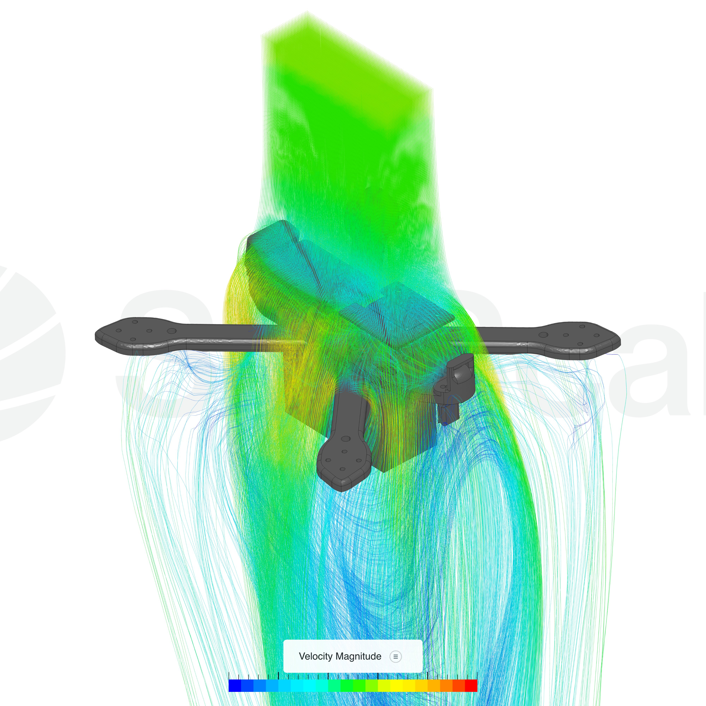

# Waterproofing-a-Drone-for-Stardance
Simply, I need some MG Chemicals products in order to conformal coat my drone ESC and FC, as well as the transmitter.
I live in a very rainy area and would love to fly my 3d Printed FPV drone in the rain, so # I need the following products:

* Black Light Flashlight, Evtek MOWETOO 395nm Mini Zoomable UV Light - https://www.amazon.com/dp/B0DN12T5DZ?psc=1&ref_=cm_sw_r_cp_ud_ct_V2YWPMTYD7QJ9TQN1SVC

* MG Chemicals 419D, the acrylic conformal coating (55 mL brush-on bottle) - https://www.amazon.com/gp/product/B07B8RY7M6/ref=ox_sc_act_title_1?smid=A15QN6QABYC6HS&psc=1

* Pro Grade Acid Brushes, 3/8 inch flux brush for glue & grease, 36 count - https://www.amazon.com/dp/B07PHG2DQY?niid=nl_cl_lst_a_1_0&ref_=nl_cl_lst_a_1_0&nrid=GP3D7KR83SW5MR47MZR4

* ELEGOO High Temp Tape, 4 pack polyimide high temperature resistant tape - https://www.amazon.com/dp/B072Z92QZ2?psc=1&ref_=cm_sw_r_cp_ud_ct_M9790J4EYZ5D7RTXBSFN

* AAWipes Cleanroom Cloth Wipes 6"x6", bag of 150 pcs, 100% polyester - https://www.amazon.com/dp/B08P2MCFK7?psc=1&ref_=cm_sw_r_cp_ud_ct_Q1X3JD038WG1KKG7QEHT_1

* MaxTite Isopropyl Alcohol 99.9%, 32 oz - https://www.amazon.com/dp/B08CGCHWMP?psc=1&ref_=cm_sw_r_cp_ud_ct_Q1X3JD038WG1KKG7QEHT_2

# TOTAL: $90.40

## Why 419D instead of 422C

Switched from MG Chemicals 422C (silicone) to 419D (acrylic) for two reasons:
- You can solder through acrylic — the soldering iron melts it, so you can rework a joint without stripping the coating first. Silicone (422C) can't be soldered through and is hard to remove.
- The 419D is a brush-on bottle, not an aerosol. Brush-on gives precise control over where the coating goes (and keeps it off connectors), with no overspray.

## Rain simulation

Rain-flow simulation: streamlines colored by velocity magnitude showing how water moves around the frame.
