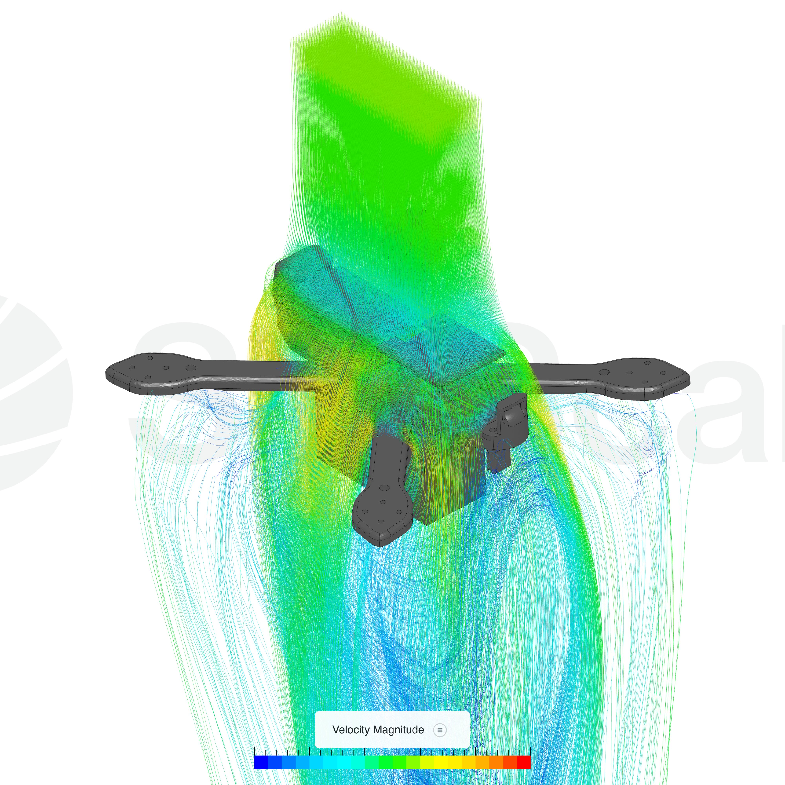

# Waterproofing-a-Drone-for-Stardance
Simply, I need some MG Chemicals products in order to conformal coat my drone ESC and FC, as well as the transmitter.
I live in a very rainy area and would love to fly my 3d Printed FPV drone in the rain, so # I need the following products:

* A Blacklight/UV A Light - https://www.amazon.com/dp/B0DN12T5DZ?psc=1&ref_=cm_sw_r_cp_ud_ct_V2YWPMTYD7QJ9TQN1SVC

* MG Chemicals 422C, the silicone conformal coating - https://a.co/d/052Aa6i4

* Polyimide Masking Tape - https://www.amazon.com/dp/B072Z92QZ2?psc=1&ref_=cm_sw_r_cp_ud_ct_M9790J4EYZ5D7RTXBSFN

* 100% Polyster Cleanroom Cloth Wipes - https://www.amazon.com/dp/B08P2MCFK7?psc=1&ref_=cm_sw_r_cp_ud_ct_Q1X3JD038WG1KKG7QEHT_1

* 99.9% IPA - https://www.amazon.com/dp/B08CGCHWMP?psc=1&ref_=cm_sw_r_cp_ud_ct_Q1X3JD038WG1KKG7QEHT_2

# TOTAL: $89.21

## Flow simulation

Velocity-magnitude streamline render of airflow around the frame.
